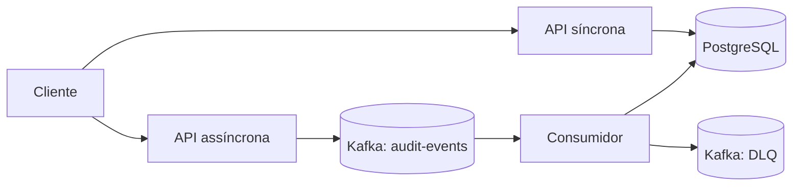

# Implementação Java — protótipo experimental de auditoria

## Finalidade e estado

**Atualização experimental de 27/10:** campanha concluída às 17h01 de Brasília: 64 completas e uma parcial A1, exatamente 65 UUIDs sem reposição. [Resultados, auditoria e limitações](experimento/campanhas/2026-10-27-reduzida65-r2/RESULTADOS.md) e [entrega datada com PDF, apresentação e roteiro](../entregas/2026-10-27-entrega-04-java-final/README.md). Aplicações e instrumentos medidos permanecem inalterados; a qualificação parcial conserva o veredito bruto e não inventa horário de commit.

Três processos executáveis implementam o mesmo contrato `AuditEvent`: `sync-api` grava antes da resposta `201`; `async-api` responde `202` após o ACK do Kafka; `consumer` grava o evento, controla tentativas/DLQ e só então confirma o offset. `audit-core` e `audit-storage` são bibliotecas compartilhadas. Esta é a implementação usada na [Entrega 03 em Java](../entregas/entrega-03-java/README.md). Artefatos históricos não fornecem resultados atribuídos à campanha atual; a comparação definitiva é identificada no catálogo R2/A1.

O build e os testes unitários são executáveis com o Maven Wrapper. O [workflow GitHub de 29/09/2026](https://github.com/ilann47/TCC-2026/actions/runs/36627197788) passou nos testes, no smoke Docker REST/Kafka/PostgreSQL e no smoke C4 de interrupção/recuperação do banco. Em 29/09/2026, o ambiente local WSL também iniciou os cinco serviços permanentes: as duas APIs retornaram `/health` 200; um POST síncrono retornou 201 e pôde ser consultado; um POST assíncrono retornou 202 e foi encontrado no banco após o consumidor processá-lo. Isso verifica o funcionamento básico, **não** fornece resultados quantitativos definitivos.

## Arquitetura



`async-api` não possui dependência de banco de dados. Os três processos compartilham o esquema do evento, o algoritmo de hash e os marcos de observabilidade. Há uma única tabela de domínio: `audit_records`. O `persisted_at` é o instante de inserção atribuído pelo banco, **não** a medição do commit; a medição de conclusão usa `commit_completed.wall_time_ns`.

| Módulo | Papel | Dependências externas em execução |
|---|---|---|
| `audit-core` | Contrato, JSON canônico, SHA-256, publicação Kafka, marcos | Nenhuma conexão própria |
| `audit-storage` | Migração Flyway, JDBC, transação e idempotência | PostgreSQL |
| `sync-api` | `POST /audit`, `GET /audit/{event_id}`, saúde | PostgreSQL |
| `async-api` | `POST /audit`, saúde | Kafka |
| `consumer` | Consumir, persistir, tentar novamente e enviar à DLQ | Kafka e PostgreSQL |

## Requisitos

- JDK 21 ou superior. O alvo de bytecode é Java 21.
- Docker com Compose para execução integrada. As portas padrão exclusivas desta versão são `18002` (API síncrona), `18003` (API assíncrona), `15433` (PostgreSQL) e `19093` (Kafka).
- Não é necessário instalar Maven globalmente: `mvnw.cmd`/`mvnw` baixa a versão fixada.

## Build e testes unitários

No PowerShell, dentro desta pasta:

```powershell
.\mvnw.cmd verify
```

No Linux/macOS: `./mvnw verify`. Os testes atuais cobrem um vetor de referência de JSON/hash, validação básica do contrato, confirmação do offset após persistência, DLQ para evento inválido, exaustão de tentativas e ausência de commit quando o ACK da DLQ falha. Eles **não substituem** um ensaio de integração com serviços reais.

## Execução isolada com Docker

O arquivo `.env` versionado contém apenas uma **senha pública de desenvolvimento local** e as portas padrão. Não a reutilize em outros sistemas nem use este ambiente com dados reais. No WSL/Linux, dentro de `implementacao-java`:

Os comandos com `--build` abaixo servem para preparar um ambiente novo. **Se as imagens já estão prontas neste computador, use a opção 1 do [menu de demonstração](#demonstração-com-menu-para-a-apresentação)**, que inicia os serviços sem recompilar. Não reconstrua as imagens usadas na campanha congelada apenas para apresentar o protótipo.

```bash
docker compose up --build -d
docker compose ps
```

Para acompanhar a inicialização: `docker compose logs -f --tail=100`. Se quiser uma senha própria, crie `.runtime/compose.env` a partir de `.env.example`, preencha `POSTGRES_PASSWORD` e use `docker compose --env-file .runtime/compose.env up --build -d`. A pasta `.runtime` permanece ignorada pelo Git. Uma senha nova no arquivo não altera automaticamente a senha de um volume PostgreSQL já inicializado.

## Testar pelo Swagger UI

Com o Compose em execução, abra o [Swagger único](http://localhost:18002/swagger-ui/index.html). No seletor superior, escolha **Síncrona (PostgreSQL)** ou **Assíncrona (Kafka)**. A interface é única, mas cada processo continua gerando seu próprio contrato: [JSON síncrono](http://localhost:18002/v3/api-docs) e [JSON assíncrono](http://localhost:18003/v3/api-docs). As portas correspondem aos valores padrão do `.env`; o Compose ajusta a configuração do seletor e as origens CORS se `SYNC_PORT` ou `ASYNC_PORT` mudarem.

Em `POST /audit`, clique em **Try it out** e depois em **Execute**. O exemplo já é válido e omite `event_id` e `occurred_at`, que são gerados pela API. Na variante síncrona, `201` confirma a transação no PostgreSQL. Na assíncrona, `202` confirma somente o ACK do Kafka; copie o `event_id` da resposta, mude o seletor para **Síncrona (PostgreSQL)** e consulte `GET /audit/{eventId}` para verificar a persistência. Pode haver um breve intervalo até o consumidor gravar o evento. O acesso cruzado à API assíncrona é liberado via CORS apenas para a origem local da interface, sem alterar o caminho usado nos experimentos.

Exemplo de evento para ambas as APIs:

```json
{
  "event_id": "123e4567-e89b-12d3-a456-426614174000",
  "event_type": "created",
  "entity_type": "order",
  "entity_id": "E1",
  "actor_id": "A1",
  "source": "manual",
  "occurred_at": "2026-09-29T12:34:56Z",
  "payload": {"value": 1}
}
```

Envie esse JSON para `http://localhost:18002/audit` (síncrono) ou `http://localhost:18003/audit` (assíncrono), com `Content-Type: application/json`. Para consultar, use `GET http://localhost:18002/audit/123e4567-e89b-12d3-a456-426614174000`. Não reutilize esse `event_id` com conteúdo diferente: a resposta será `409` na variante síncrona e a mensagem irá para a DLQ na assíncrona.

Para desligar sem apagar dados: `docker compose down`. O comando `down -v` apaga os volumes desta versão; use-o apenas se desejar descartar deliberadamente o banco e o Kafka locais.

## Contratos e significado das confirmações

| Operação | Sucesso | Significado |
|---|---:|---|
| `POST /audit` síncrono | `201` | A transação de persistência terminou; `status=persisted` ou `duplicate`. |
| `POST /audit` assíncrono | `202` | O broker confirmou a publicação; a persistência ainda pode estar pendente. |
| `GET /audit/{event_id}` síncrono | `200` | Registro presente; `404` se ausente. |
| `GET /live` | `200` | Processo HTTP ativo. |
| `GET /health` | `200` ou `503` | Dependência principal disponível ou indisponível. |

O consumidor é **at-least-once**. Reentrega pode ocorrer após falha de commit de offset. A PK `event_id` e a comparação do hash impedem uma segunda linha para o mesmo conteúdo; isso não equivale a “exactly once” de ponta a ponta. Se o banco estiver indisponível durante as tentativas, a mensagem é enviada à DLQ após o orçamento configurado. A DLQ pode conter o evento original em Base64 e exige proteção de acesso.

## Configuração e observabilidade

As variáveis principais são `SPRING_DATASOURCE_URL`, `SPRING_DATASOURCE_USERNAME`, `SPRING_DATASOURCE_PASSWORD`, `KAFKA_BOOTSTRAP_SERVERS`, `KAFKA_TOPIC`, `KAFKA_DLQ_TOPIC`, `KAFKA_GROUP_ID`, `DELIVERY_TIMEOUT_MS`, `RETRY_ATTEMPTS`, `RETRY_BACKOFF_MS`, `RETRY_BACKOFF_MAX_MS` e `RECONNECT_MS`. O header opcional `X-Run-ID` deve ser UUID; ele identifica uma execução experimental e não participa do hash. Logs JSON emitem `request_received`, `broker_acknowledged`, `commit_completed`, `persistence_confirmed`, `dlq_acknowledged` e `offset_committed`, sem registrar payload ou credenciais.

## Demonstração com menu para a apresentação

### Abrir pelo PowerShell no Windows

Abra o Windows Terminal/PowerShell e cole o comando abaixo. Ele entra no WSL e abre o menu Bash no terminal atual:

```powershell
wsl --cd /mnt/c/Users/ilan.wendling/OneDrive/sistemasDeInformacao/TCC/TCC-2026/implementacao-java -- bash demo/apresentacao.sh
```

Esse é o caminho desta máquina; ajuste o argumento de `--cd` se o clone estiver em outra pasta. Os arquivos continuam no Windows, acessíveis em `/mnt/c/` no WSL. O Docker precisa estar acessível no WSL utilizado. Neste projeto, **k6 e Java rodam em contêineres**: não é preciso abrir um aplicativo k6 nem instalá-lo no Windows para usar esse menu. Docker com Compose, `curl`, Python 3 e as imagens Java devem estar preparados antes da banca.

Se você já estiver em um terminal Ubuntu/WSL, entre em `implementacao-java` e execute `bash demo/apresentacao.sh`. Não execute esse script Bash diretamente no PowerShell ou Git Bash; no PowerShell, use a chamada `wsl` acima.

### Preparar e demonstrar

1. No menu, escolha **1**. Ela inicia/confere `sync-api`, `async-api`, PostgreSQL, Kafka e consumidor sem build, aguarda a saúde das APIs e obtém a imagem fixada do k6 se estiver ausente. Prepare isso com internet antes da banca, não durante a apresentação.
2. Escolha **2** para conferir os serviços e o endereço real do Swagger. Abra o navegador do Windows no [Swagger local](http://localhost:18002/swagger-ui/index.html), porta padrão. O seletor superior alterna entre **Síncrona (PostgreSQL)** e **Assíncrona (Kafka)**.
3. Siga a sequência abaixo. Após cada ação, pressione **Enter** para voltar ao menu. O menu guarda o último UUID da sessão para consultar o mesmo evento.

| Etapa | Opções, nesta ordem | O que conferir |
|---|---|---|
| Síncrona | **3**, **5** | POST 201 e consulta 200: registro presente no banco. |
| Assíncrona normal | **4**, **7**, **5** | POST 202 e consulta 200 após o consumidor processar. |
| Consumidor parado | **6**, **4**, **5**, **8** | Enviar um evento novo após a parada: POST 202, consulta 404 e eventual lag Kafka. |
| Retomada | **7**, **5** | Conferir se o mesmo UUID aparece no banco; o menu aguarda até 60 s. |
| k6 síncrono e assíncrono | **9**, depois **10** | Consumidor retomado; cada carga usa, por padrão, 5 eventos/s durante 20 s. |
| Recursos e encerramento | **11**, depois **0** | Ver amostra de CPU/memória/logs e sair. Sair não desliga os cinco serviços. |

O 201 síncrono confirma a transação; o 202 assíncrono confirma somente a publicação no Kafka. O resumo curto do k6 mede HTTP, não o tempo de conclusão da persistência assíncrona. Uma consulta não confirmada, erro ou teste reprovado deve ser explicado como tal. Essa demonstração não substitui os resultados da campanha definitiva de 65 tentativas.

Para apenas verificar a prontidão pelo PowerShell, **sem enviar eventos, iniciar/parar contêineres ou baixar imagens**, use:

```powershell
wsl --cd /mnt/c/Users/ilan.wendling/OneDrive/sistemasDeInformacao/TCC/TCC-2026/implementacao-java -- bash demo/apresentacao.sh --check
```

Se faltar alguma dependência, imagem ou serviço, a verificação informa o problema; ela não o corrige automaticamente. Se o consumidor ficar parado após uma saída abrupta, consulte a recuperação no [guia da demonstração](demo/README.md#5-segurança-e-arquivos).

### Comparação completa e roteiro para a banca

**Antes da apresentação**, use **13**, depois o cenário **1** (normal), para preparar uma comparação síncrona/assíncrona. Preparação, coleta e exportação levam alguns minutos além da janela de carga. **Durante a banca**, use **14** para reapresentar a última comparação concluída, sem nova carga, e abra o `relatorio.html` pelo caminho exibido. Confira o cenário e os identificadores desse relatório. Os cenários de falha também existem na opção 13, mas não é necessário executá-los todos ao vivo.

Leia o [passo a passo completo e as falas de cada etapa](demo/README.md) e o [guia das métricas e falas](demo/METRICAS-E-FALAS.md) para ensaiar. Não execute a campanha longa durante a apresentação.

O menu não recompila imagens nem inicia a campanha definitiva. As opções 1 a 12 preservam os dados do projeto principal. A comparação 13 reinicia somente a tabela experimental isolada, preserva exportações e para seu ambiente ao terminar. Relatórios ficam em `.runtime/demonstracao/` e evidências da comparação em `.runtime/entrega04/`, identificados como demonstração/validação, nunca como resultados definitivos. Se houver ensaio isolado ativo, as ações de demonstração são recusadas. Na saída tratável, o menu tenta retomar o consumidor somente se ele próprio o tiver pausado; os demais serviços continuam ativos.

## Medição e campanha experimental

Os [instrumentos com k6 e analisador Java](experimento/README.md) medem resposta HTTP e persistência separadamente, conciliam conteúdo/hash e acompanham throughput, pendências, lag Kafka, CPU/memória do sistema e dos coletores e recuperação sustentada. A [calibração de 26/10/2026](experimento/calibracao/2026-10-26-529e0349/README.md) confirmou **48 eventos/s** em cinco minutos por variante; os dois ensaios salvaram todos os 14.401 registros medidos, sem erros ou drops. Não são repetições definitivas nem conclusões para os capítulos 5 e 6.

O [protocolo experimental](experimento/PROTOCOLO-ENTREGA04.md) usa projeto experimental isolado, conteúdo determinístico comum, carga a 12/24/36/48 eventos/s, rajada 48→96→48 e falhas de PostgreSQL/consumidor. A revisão [R2 de 65 execuções](experimento/campanhas/2026-10-27-reduzida65-r2/README.md), com cinco repetições e 180 s medidos, passou nas nove validações em 27/10/2026 e foi congelada como `ready_for_definitive_runs`, mantendo 48/s. A R1 não elegível e a V1 de 130 permanecem preservadas. A R2 muda apenas a sonda periódica experimental do Kafka para TCP leve, mantendo verificações semânticas antes da carga e os critérios. Piloto aprovado não é campanha concluída: consulte o diário com `python3 experimento/reduced_campaign.py status` e os [comandos e limites](experimento/ENTREGA04.md). O controlador para somente os contêineres interativos deste TCC que estavam ativos e os retoma ao final ou em saída tratável; não reinicializa o banco interativo nem para projetos alheios. Não execute o menu de demonstração nem outro ensaio enquanto a campanha estiver ativa. Os scripts `pilot.sh`/`pilot.js` e `.runtime/pilot/` permanecem como histórico do piloto inicial.

## Escopo da pesquisa e limitações

A configuração de Compose usa uma partição e uma réplica Kafka em ambiente local, cargas sintéticas e limites de recursos explícitos. Ela serve à comparação controlada, não a uma implantação de produção. O cenário C4 previsto interrompe o **PostgreSQL em ambas as variantes**. Nenhum número de latência, throughput ou taxa de erro deve ser tratado como conclusão antes de o protocolo experimental estar congelado e executado. Consultar [paridade](docs/paridade.md) e [especificação](docs/especificacao/README.md).

Referências técnicas usadas nas escolhas de implementação: [Spring Boot 3.5 — requisitos](https://docs.spring.io/spring-boot/3.5/system-requirements.html), [Spring JDBC](https://docs.spring.io/spring-boot/reference/data/sql.html), [Kafka Consumer API](https://kafka.apache.org/39/javadoc/org/apache/kafka/clients/consumer/KafkaConsumer.html), [timeouts do pgJDBC](https://jdbc.postgresql.org/documentation/use/) e [Maven Wrapper](https://maven.apache.org/tools/wrapper/maven-wrapper-plugin/usage.html). Elas não substituem os artigos científicos citados no TCC.
